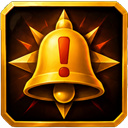
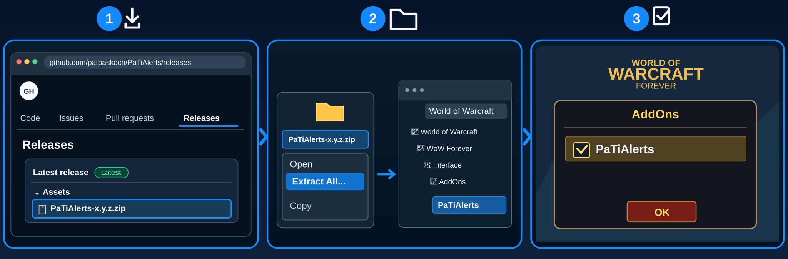

# PaTiAlerts



## Install

**📥 [Download PaTiAlerts Beta](https://github.com/patpaskoch/PaTiAlerts/releases/download/v0.1.0-beta.1/PaTiAlerts-0.1.0-beta.1.zip)** · [Installation guide](#installation)

*Installation-test preview — not yet a stable release.*

## What is PaTiAlerts?

**Know what needs attention. Skip the noise.**

When a fight gets messy, the important things can get lost in the chaos. PaTiAlerts brings warnings from your other PaTi addons into one calm, clear place — so you notice the problem and decide what to do next.

## Features

- **The important stuff first:** Critical, warning and information alerts.
- **Spot lost aggro:** See enemies that need a tank's attention.
- **Catch missing buffs:** Notice effects that are missing or running out.
- **Help your party:** See reported debuffs you can remove.
- **No extra noise:** Alerts clear when the issue is gone; the addon is optional.

## Installation



1. 📥 **Download** – Open [GitHub Releases](https://github.com/patpaskoch/PaTiAlerts/releases) and download the `PaTiAlerts-<version>.zip` file under **Assets** (not **Source code (zip)**).
2. 📂 **Extract & Copy** – Right-click the ZIP, select **Extract All**, then copy the extracted `PaTiAlerts` folder into the WoW Forever client's `Interface/AddOns/` folder. No renaming is needed.
3. ☑️ **Enable in Game** – Start WoW, open the **AddOns** menu at character selection, tick **PaTiAlerts**, and click **OK**.

💡 **Tip – Find your AddOns folder:** In the Battle.net launcher, select the WoW version you play, click the **gear icon next to Play → Show in Explorer** (*Im Explorer anzeigen*), then open that client's `Interface/AddOns/` folder. If Battle.net opens the main World of Warcraft folder instead, open the appropriate version folder first. On Mac, use **Show in Finder**.

**Optional:** Install PaTiAggro, PaTiAuras, or PaTiHeal as alert sources; PaTiAlerts also loads on its own.

## Getting Started

- `/pal test` shows one example of each priority — move the window where you look while playing, then lock it
- `/pal settings` to choose sources and priorities

## Settings

`/pal settings` or ••• → Settings:
- **Sources:** PaTiAggro, PaTiAuras, PaTiHeal on/off (only what PaTiAlerts shows; the addons keep working)
- **Priorities:** critical, warnings, notes on/off
- **Behaviour:** briefly highlight new alerts; hide automatically when empty
- **General:** language, scale, window lock
- **Window:** panel opacity (30–100 %)

## Important notes

> **Installation-test beta available:** [Download the current ZIP from Releases](https://github.com/patpaskoch/PaTiAlerts/releases). This is an unverified preview for testing the installation, not a stable release.

> Status: 0.1.0, in development, not yet stable. Not yet tested in game.

## Feature details

- One line per open problem, most urgent first: **red** critical, **yellow** warning, **blue** note
- From **PaTiAggro:** enemies you lost (`1 Kultist → Healer`, critical) or barely hold (warning) — with the same number
  that PaTiAggro shows in its panel and above the enemy's nameplate
- From **PaTiAuras:** your watched buffs and (Shaman) weapon imbues that are missing or expiring (warning), and
  watched group buffs someone lacks — one line per buff (`Power Word: Fortitude · Missing on 2`), names stay in the
  PaTiAuras tooltip. "Unclear" data, offline and dead members never show up as missing
- From **PaTiHeal:** party members with a debuff you can dispel (note)
- A new alert (or one that got more severe) is highlighted once, briefly; nothing blinks
- Hides itself when there is nothing to show (while locked); unlocked or in test mode it stays so you can place it
- **Click a PaTiAuras row** (out of combat): a missing buff, weapon imbue or tracking is cast on you, a missing group
  buff on the member PaTiAuras chose — exactly what a click on that line in PaTiAuras does. One click = one cast. In
  combat the rows are not clickable (WoW does not let an addon change what a click casts while rows move)
- Aggro rows are not clickable: to act on `1 Kultist`, click that enemy's nameplate marked "1" and taunt yourself
- ••• menu: Settings, Lock, Collapse, Test Mode, Hide. Languages: English, Deutsch (others fall back to English)

PaTiAlerts is **optional**: PaTiAggro, PaTiAuras and PaTiHeal work exactly the same without it. It only shows what
they report while it is installed.

## PaTiSuite

This addon is part of the **PaTiSuite** — a collection of small addons for World of Warcraft: Forever.
Each one is installed on its own and works on its own; none of them is needed by another.

- [PaTiSuite](https://github.com/patpaskoch/PaTiSuite) – optional control panel to show and hide the PaTi windows
- [PaTiHeal](https://github.com/patpaskoch/PaTiHeal) – healing: party frames, heal target, click casting, HoTs, dispels
- [PaTiAuras](https://github.com/patpaskoch/PaTiAuras) – buffs, procs, tracking, group buffs and weapon imbues
- [PaTiAggro](https://github.com/patpaskoch/PaTiAggro) – aggro for tank, healer and damage (formerly PaTiTank)
- [PaTiRota](https://github.com/patpaskoch/PaTiRota) – your own skill priority with cooldowns and fixed cast buttons
- [PaTiGroup](https://github.com/patpaskoch/PaTiGroup) – party awareness: tank, healer, roles and the tank's target
- [PaTiLead](https://github.com/patpaskoch/PaTiLead) – lead the group: raid markers, ready check and pull timer
- [PaTiQuest](https://github.com/patpaskoch/PaTiQuest) – selected quest and its objectives
- [PaTiDungeon](https://github.com/patpaskoch/PaTiDungeon) – instance, group and combat status
- [PaTiSocial](https://github.com/patpaskoch/PaTiSocial) – "Party Social": quick emote and message buttons
- **PaTiAlerts** – one window for open problems *(this addon)*

### Current sources

- [PaTiAggro](https://github.com/patpaskoch/PaTiAggro) – enemies you lost or barely hold (same number as in PaTiAggro and on the nameplate)
- [PaTiAuras](https://github.com/patpaskoch/PaTiAuras) – your watched buffs, weapon imbues and group buffs that are missing or expiring
- [PaTiHeal](https://github.com/patpaskoch/PaTiHeal) – party members with a debuff you can dispel

PaTiAlerts is optional: PaTiAggro, PaTiAuras and PaTiHeal work fully without it. [PaTiSuite](https://github.com/patpaskoch/PaTiSuite) can show and hide this window together with the others.

## Commands

`/pal` or `/palerts` — alone: show/hide · `settings` · `test` · `show` · `hide` · `lock` · `unlock` · `reset` (position) ·
`debug` · `version`

## For addon authors (PaTiSuite)

Local API, version 1 — call it only if it exists, never depend on it:
```lua
local api = _G.PaTiAlertsAPI
if type(api) == "table" and api.version == 1 then
    pcall(api.Sync, "PaTiAggro", { { id = "aggro:<guid>", priority = "CRITICAL", kind = "AGGRO_LOST",
        number = 1, name = enemyName, detail = "Healer" } })
end
```
`Sync(source, list)` replaces the source's alerts (missing ones disappear); also `Upsert(alert)`, `Remove(source, id)`,
`ClearSource(source)`. `source`, `id`, `kind`, `priority` (`CRITICAL` / `WARNING` / `INFO`), `text`, `detail` must be
plain strings; `name` may be a restricted value (only displayed). Optional `cast = { spell = "<cast name>", unit =
"player" | "party1".."party4" }` makes the row clickable out of combat (one click = that cast); any other unit, a
secret or overlong spell drops only the click. Invalid data is dropped, never an error.

## Known limitations

- In-game test status: [`INGAME_TESTING.md`](INGAME_TESTING.md). The producers' alerts depend on their own (partly
  unconfirmed) WoW APIs; Shaman weapon imbues currently read "missing" even while active (PaTiAuras).
- No alerts from PaTiGroup, PaTiLead, PaTiRota, PaTiQuest or PaTiDungeon yet.

## Development

Architecture, tests and engineering rules of the suite: [PaTiAdmin](https://github.com/patpaskoch/PaTiAdmin). PaTiAdmin is not a WoW addon — players do not install it. The shared UI code (PaTiShared) is already embedded in this addon's `Shared/` folder; there is nothing extra to install.

## License

MIT — see [LICENSE](LICENSE). Copyright (c) 2026 Patrick Koch.
